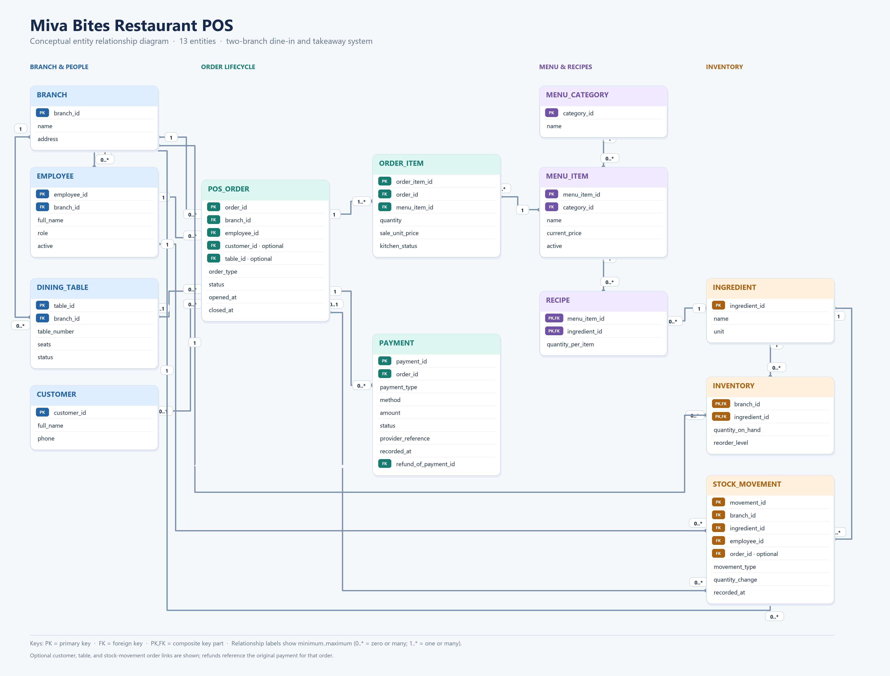

# Portfolio 1: Database Design and Modelling

**Status:** PostgreSQL schema implemented and validated; ERD and assumptions remain under review.

## Case study

Miva Bites is a simulated two-branch restaurant using a POS system for dine-in and takeaway orders. Cashiers create orders and record payments, kitchen staff update item preparation status, stock clerks maintain ingredient balances, and managers review menu, sales, and stock information. The database covers branches, employees, tables, optional customers, menu items, recipes, ingredients, inventory, orders, order items, payments, and stock movements.

## Draft ER diagram

View the [scalable SVG diagram](er-diagram.svg) or the [Mermaid source and design notes](er-diagram.md). The 13-entity model is being reviewed against the business rules.

## Relational schema draft

- [Schema design, relationship review, constraints, and normalization](schema-design.md)
- [PostgreSQL DDL draft](schema.sql)

The schema has been applied to an isolated PostgreSQL 18 database with fictional data. See the [seed data](seed.sql), [repeatable validation checks](verify.sql), and [validation output](../../Evidence/portfolio1-validation-output.txt).

## Reproduce in PostgreSQL with pgAdmin 4

This portfolio was applied and checked with PostgreSQL 18 using pgAdmin 4.

1. Create a new, empty database (for example, `miva_bites_ca_practice`).
2. Open that database's **Query Tool** and run these files in order: `schema.sql`, `seed.sql`, then `verify.sql`.
3. Confirm that `public` contains 13 tables and that `verify.sql` returns 12 `PASS` rows.

The SQL files are in this portfolio folder. `schema.sql` and `seed.sql` are intended for a fresh database; the seed uses fixed IDs, so run them only once per database. For another practice run, create another empty database. See the [pgAdmin validation screenshot](../../Evidence/screenshots/Screenshot%202026-11-07%20054948.png) and the [text validation transcript](../../Evidence/portfolio1-validation-output.txt).

## Design decisions to carry into the relational schema

- Use a separate `ORDER_ITEM` row for each menu item on an order.
- Store the unit price on `ORDER_ITEM` at sale time; do not calculate historical sales from today's menu price.
- Model the many-to-many relationship between menu items and ingredients with `RECIPE`.
- Store inventory by `(branch_id, ingredient_id)` and retain a `STOCK_MOVEMENT` audit ledger.
- Keep `PAYMENT` attempts separate so failed attempts and refunds remain visible.
- Enforce branch consistency for the order, assigned table, employee, inventory, and stock movement.
- Keep walk-in customers optional; use fictional customer data in examples.

## Required evidence checklist

- [ ] Final case study description and requirements
- [ ] Review and approve ER diagram
- [x] Relational schema draft and data types
- [x] Primary keys, foreign keys, unique/check constraints drafted
- [x] Normalization explanation drafted
- [x] Schema implementation and validation output
