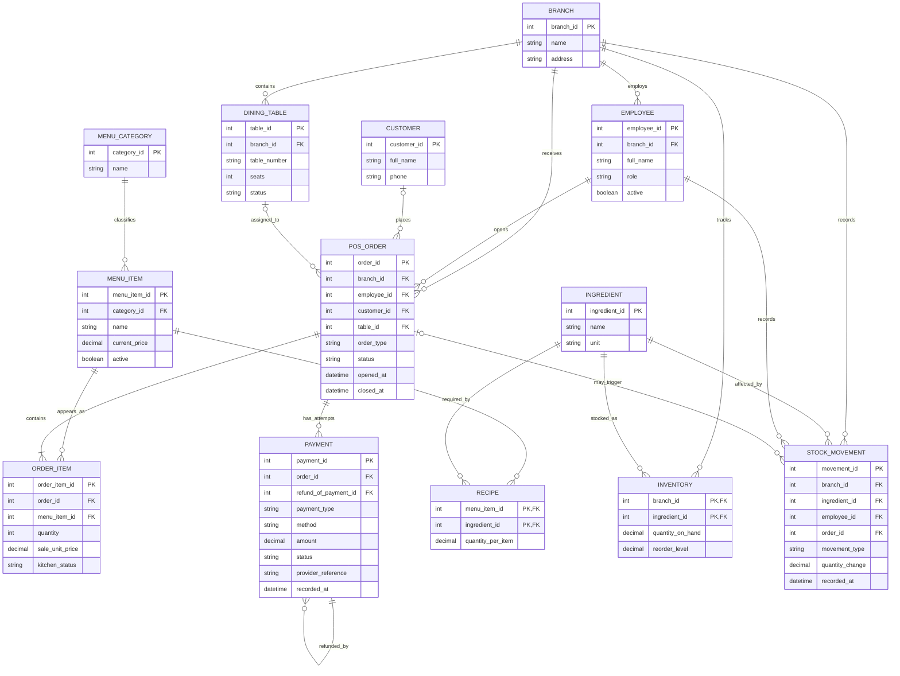

# Miva Bites POS - Draft ER Diagram

This diagram is the starting conceptual model for the case study. It will be checked against the business rules before we write the PostgreSQL schema.

Rendered versions: [PNG preview](er-diagram.png) · [scalable SVG](er-diagram.svg).

## Relationship and constraint notes

- A customer and dining table are optional for an order. A dine-in order must have a table; a takeaway order must not.
- The relational design uses composite foreign keys to enforce that an order's employee and table belong to the same branch as the order, and that a stock movement's employee, order, and inventory belong to its branch.
- Each order item refers to one menu item and one order. Each placed order must have at least one item.
- A menu item can use multiple ingredients; each recipe row records the quantity of one ingredient used for one menu item.
- `INVENTORY` is the current branch-level balance. `STOCK_MOVEMENT` records each increase or decrease; both are updated in the same transaction.
- Payment rows represent attempts or refunds. A refund references the original charge for the same order; payment/order statuses, positive amounts, and movement signs are constrained in the relational schema.
- The current menu and prices are shared across both branches; inventory and sales are branch-specific in this first version.
- Order totals and successful payment/refund totals are derived and reconciled in transaction logic; they are not duplicated as stored totals.

See [schema-design.md](schema-design.md) for the relationship review, normalization notes, and cross-row rules. See [schema.sql](schema.sql) for the PostgreSQL DDL draft.
