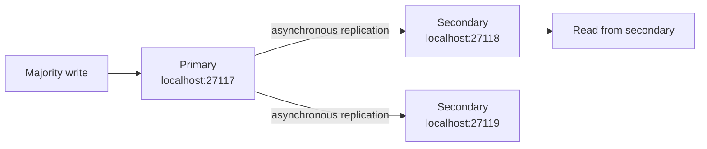

# Portfolio 5: Distributed and Cloud Databases

**Status:** The local replica-set exercise ran successfully on 10 November 2026. The implementation results are recorded below; screenshots still need to be saved in the evidence folder.

## Chosen exercise: replication with a MongoDB replica set

The CA brief offers replication, sharding, availability, consistency, or deployment as possible directions for this portfolio. This project demonstrates replication using three local `mongod` processes: one primary and two secondary members. It builds on the MongoDB tools already used for Portfolio 4 and avoids creating a cloud account or changing the existing MongoDB service.

All three nodes run on this computer for a controlled classroom demonstration. They use ports `27117`, `27118`, and `27119`, separate data folders under `%LOCALAPPDATA%\MivaBitesReplicaLab`, and the replica-set name `mivaBitesRS`. The existing MongoDB service on port `27017` and Portfolio 4 database remain separate.



MongoDB replica-set writes go to the primary; secondaries copy changes from the primary's operation log. A write with `w: "majority"` waits for a calculated majority of data-bearing voting members to acknowledge it. This lab then explicitly reads the demo order from a secondary. This local setup demonstrates those database behaviors; it is not a production multi-computer deployment.

## Files

- [`start-replica-nodes.ps1`](start-replica-nodes.ps1) finds the installed MongoDB server, creates three separate local data/log folders, and starts three local-only server processes on the lab ports.
- [`initiate-replica-set.js`](initiate-replica-set.js) configures the three members as `mivaBitesRS`.
- [`replica-status.js`](replica-status.js) prints each member's state and health.
- [`write-majority-order.js`](write-majority-order.js) upserts a Miva Bites example order using majority write concern.
- [`read-from-secondary.js`](read-from-secondary.js) reads that order through a secondary-only connection.
- Screenshots belong in [`Evidence/portfolio5`](../../Evidence/portfolio5/).

## Beginner run steps on Windows

Run the commands in order. Open PowerShell in the project folder. The first command below moves PowerShell to the project folder used on this computer.

1. Start the three local nodes. The script keeps their windows hidden and writes logs under `%LOCALAPPDATA%\MivaBitesReplicaLab`.

   ```powershell
   Set-Location "C:\Users\User\Documents\Miva\Courses\First Semester\MIT 8103 - Advanced Database Systems\Advanced DB CA"
   & ".\Portfolios\portfolio-5-distributed-cloud-databases\start-replica-nodes.ps1"
   ```

   Expected message: all three ports `27117`, `27118`, and `27119` are listening. If the script says a port is already in use, stop and tell me before continuing.

2. Initialize the replica set once:

   ```powershell
   mongosh "mongodb://localhost:27117" --file "C:\Users\User\Documents\Miva\Courses\First Semester\MIT 8103 - Advanced Database Systems\Advanced DB CA\Portfolios\portfolio-5-distributed-cloud-databases\initiate-replica-set.js"
   ```

3. Wait about 10 seconds for the election, then inspect the three member states:

   ```powershell
   mongosh "mongodb://localhost:27117,localhost:27118,localhost:27119/?replicaSet=mivaBitesRS" --file "C:\Users\User\Documents\Miva\Courses\First Semester\MIT 8103 - Advanced Database Systems\Advanced DB CA\Portfolios\portfolio-5-distributed-cloud-databases\replica-status.js"
   ```

   Expect one `PRIMARY` and two `SECONDARY` members, each with health `1`.

4. Write one example Miva Bites order with majority acknowledgment:

   ```powershell
   mongosh "mongodb://localhost:27117,localhost:27118,localhost:27119/?replicaSet=mivaBitesRS" --file "C:\Users\User\Documents\Miva\Courses\First Semester\MIT 8103 - Advanced Database Systems\Advanced DB CA\Portfolios\portfolio-5-distributed-cloud-databases\write-majority-order.js"
   ```

5. Read the replicated order from the secondary on port `27118`:

   ```powershell
   mongosh "mongodb://localhost:27118/?directConnection=true&readPreference=secondary" --file "C:\Users\User\Documents\Miva\Courses\First Semester\MIT 8103 - Advanced Database Systems\Advanced DB CA\Portfolios\portfolio-5-distributed-cloud-databases\read-from-secondary.js"
   ```

6. Run the member-status command again and capture the outputs: one screenshot showing the three member states, one showing the majority-write result, and one showing the secondary read. Save them in `Evidence/portfolio5`.

If you clone the project to a different folder, replace the project path in the commands with the full path to your copy. Do not delete the replica-set data folders while the nodes are running.

## What the evidence demonstrates

- A replica set has one primary and two healthy secondaries.
- The example order is acknowledged with `w: "majority"`.
- A read directed to a secondary returns the order that was written through the replica set.
- Replication copies data; the members in this classroom simulation still share one physical computer, so the setup does not prove protection against loss of that computer.

## Results observed on 10 November 2026

- `rs.status()` showed `localhost:27119` as `PRIMARY` and `localhost:27117` plus `localhost:27118` as `SECONDARY`; all three reported health `1`.
- The sample order write returned `acknowledged: true` and `upsertedCount: 1` with majority write concern.
- A secondary-only connection to `localhost:27118` returned order `P5-ORDER-9501`, including its menu item, quantity, and total.
- The final status check again showed one healthy primary and two healthy secondaries.

Save the PowerShell screenshots for the replica status, acknowledged write, and secondary read in `Evidence/portfolio5/` before submission.

## References

- MongoDB, [Deploy a self-managed replica set](https://www.mongodb.com/docs/manual/tutorial/deploy-replica-set/).
- MongoDB, [Replication and replica-set fundamentals](https://www.mongodb.com/docs/manual/replication/).
- MongoDB, [Write concern for replica sets](https://www.mongodb.com/docs/manual/core/replica-set-write-concern/).
- MongoDB, [Run JavaScript files from `mongosh`](https://www.mongodb.com/docs/mongodb-shell/write-scripts/).
