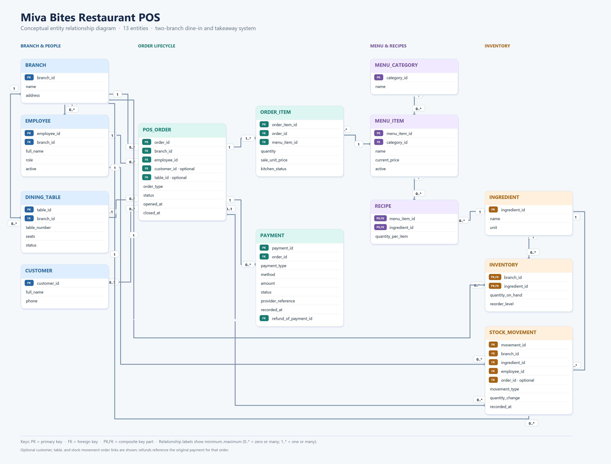

# MIT 8103 Advanced Database Systems CA

Individual practical database portfolio for the 2026/2027 First Semester Continuous Assessment. The target submission date is 15 November 2026.

## Case study: Miva Bites Restaurant POS

Miva Bites is a simulated two-branch restaurant. Its point-of-sale system supports dine-in and takeaway orders, kitchen preparation, payment recording, menu management, and ingredient inventory. The same case study will be used throughout all five portfolio activities.

### Database users

- **Cashiers** open orders, add menu items, and record payment attempts.
- **Kitchen staff** update the preparation status of order items.
- **Stock clerks** receive and adjust ingredient stock.
- **Managers** maintain menu information and review branch sales and stock reports.
- **Customers** may be associated with an order, but customer details are optional for walk-in sales.

### Main data

Branches, employees, dining tables, optional customers, menu categories and items, ingredients, recipes, branch inventory, orders, order items, payments, and stock movements.

### Key operations

1. Open a dine-in or takeaway order at a branch.
2. Add items using the current menu price, preserving the price charged on each order item.
3. Send items to the kitchen and track their preparation status.
4. Record successful, failed, or refunded payment activity.
5. Consume recipe ingredients when an order enters preparation, and record restocking or adjustments as stock movements.
6. Report sales by branch and date, popular menu items, and ingredients below their reorder level.

### Working business rules

- Each order belongs to one branch and is opened by an employee assigned to that branch.
- Dine-in orders use a dining table at the same branch; takeaway orders do not use a table.
- An order must contain at least one item before it is placed.
- The order item stores the sale-time unit price so later menu price changes do not rewrite sales history.
- Inventory is tracked by branch and ingredient. Its balance and stock movement ledger are updated together in a database transaction, and stock cannot become negative.
- Payment attempts are kept as separate records. Only successful payments count toward settlement; refunds remain auditable.
- Customer information is optional and sample data will be fictional.
- Both branches share the same menu catalogue and current prices in the first version; inventory and sales remain branch-specific.
- Online delivery, payroll, reservations, loyalty points, and a customer-facing app are outside the initial scope.

## Conceptual ER diagram

Open the [scalable SVG](Portfolios/portfolio-1-database-design/er-diagram.svg) or the [Mermaid source and design notes](Portfolios/portfolio-1-database-design/er-diagram.md). The diagram is a draft and will be refined as we confirm the business rules and relational constraints.

The matching [relational schema review](Portfolios/portfolio-1-database-design/schema-design.md) and [PostgreSQL DDL draft](Portfolios/portfolio-1-database-design/schema.sql) map the model to tables, keys, and constraints.

## Portfolio roadmap

| Activity | Marks | Planned evidence | Status |
|---|---:|---|---|
| Portfolio 1: Database design and modelling | 7 | Case description, ER diagram, relational schema, keys, constraints, normalization explanation | In progress: schema implemented and constraints validated |
| [Portfolio 2: Query processing and optimisation](Portfolios/portfolio-2-query-processing-and-optimisation/README.md) | 7 | SQL, query results, execution plans, indexes, performance analysis | Complete: query results, scaled plans, and index comparison documented |
| [Portfolio 3: Transactions and concurrency](Portfolios/portfolio-3-transactions-and-concurrency/README.md) | 7 | Commit, rollback, isolation, concurrency issue and control, output evidence | Complete: transaction, isolation, and concurrent stock-control examples with screenshots |
| [Portfolio 4: NoSQL and advanced data models](Portfolios/portfolio-4-nosql-and-advanced-data-models/README.md) | 7 | NoSQL model, implementation evidence, suitability explanation | In progress: setup, queries, and embedded-document view captured; indexes and validation evidence next |
| Portfolio 5: Distributed and cloud database exercise | 6 | Replication, sharding, availability, consistency, or deployment evidence | Not started |
| Final documentation and technical reflection | 6 | 2-3 page LMS summary, repository link, evidence, reflection, references, AI-use declaration | Not started |

## Repository and evidence

The course brief expects a private GitHub repository with progressive commits, SQL scripts, schemas, ER diagrams, implementation evidence, screenshots or outputs, and clear README files. The [GitHub repository](https://github.com/tenternet/MIT-8103-CA) is initialized and receiving progressive portfolio commits. Assessor access still needs to be confirmed before submission.

Evidence will be organized under `Evidence/`, with portfolio work under `Portfolios/`. Each activity README will describe how to reproduce and verify its work. The GitHub repository and LMS submission must both be ready before the target date.

## Technical direction

The initial plan is PostgreSQL for the relational schema, SQL, query plans, and transaction work; MongoDB for the document-model exercise. The distributed/cloud exercise will use a reproducible approach selected when we reach Portfolio 5. These are working choices and can be adjusted before implementation.

## Academic integrity and AI use

This is an individual assessment. The student must understand and verify each design, query, result, and explanation. Any AI assistance must be declared as required by the course brief, including the tool used, what it helped with, and how its output was reviewed, corrected, tested, or verified.
